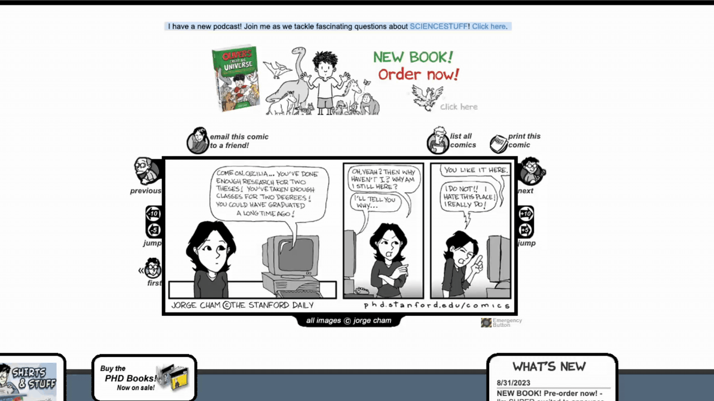
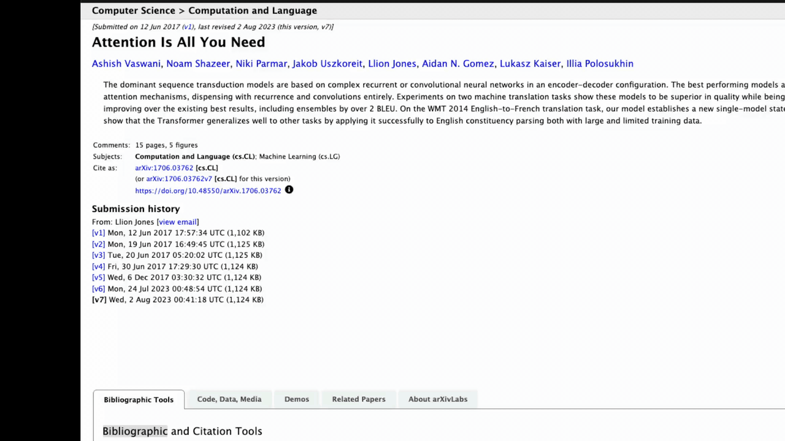

# Anywhere Plamo

選択した文章をショートカットで翻訳する、Linux・macOS向けの非公式PLaMoクライアントです。PLaMo 3 Translate 0.8Bを端末上で動かし、モデル取得後はオフラインで翻訳できます。

<table>
  <tr><th>OCRレンズ</th><th>選択した文章の翻訳</th></tr>
  <tr>
    <td width="50%"></td>
    <td width="50%"></td>
  </tr>
</table>

## セットアップ

Mac（macOS 13.3以降）では[Releases](https://github.com/romanohu/anywhere-plamo/releases/latest)から、Apple Silicon用の`aarch64.dmg`またはIntel用の`x64.dmg`を取得し、アプリを「アプリケーション」へ移動してください。

Mac版はアドホック署名のみで未公証です。初回起動がブロックされた場合は「システム設定 → プライバシーとセキュリティ → このまま開く」から許可してください。

### ソースから起動

Node.js 24、Rust 1.90以上、Python 3.12または3.13、CMake、C/C++コンパイラと[TauriのOS別依存](https://v2.tauri.app/start/prerequisites/)が必要です。

Ubuntu / Debianの追加パッケージ:

```sh
sudo apt install build-essential cmake pkg-config python3-venv libwebkit2gtk-4.1-dev \
  libayatana-appindicator3-dev librsvg2-dev libxdo-dev libssl-dev
```

macOSではXcode Command Line ToolsとCMakeを用意してください。

Windows 11 x64版は開発中で、実機動作は未確認です。Visual Studio Build Toolsの「C++によるデスクトップ開発」、WebView2、Visual C++再頒布可能パッケージを用意してください。以下の`npm run runtime:build`は`py -3.12 scripts/build-runtime.py`に置き換えます。CPUが既定で、Vulkan SDKを用意すれば`--backend vulkan`でGPU版をビルドできます。

リポジトリのディレクトリで実行します。

```sh
git clone https://github.com/romanohu/anywhere-plamo.git
cd anywhere-plamo
npm ci
npm run runtime:build
npm run tauri dev
```

推論エンジンとPaddleOCRの小型モデル・実行環境（日本語・英語・韓国語、日本語の縦書きを含む）は初回に取得・ビルドされます。配布版ではPythonのインストールは不要です。既存のソース版は `npm run ocr:build` でOCRデータを更新してください。翻訳の推論は既定でLinux・WindowsはCPU、macOSはMetalを使用します。OCRは各OSともCPUで動きます。

配布用ファイルを作る場合:

```sh
python3 scripts/collect-licenses.py
npm run tauri build
```

成果物は`src-tauri/target/release/bundle/`に生成されます。アプリ内更新用の配布物とMacの継続した署名については[更新の配布手順](docs/updating.md)を参照してください。

Windowsでは`py -3.12 scripts/collect-licenses.py`の後、`npm run tauri -- build --bundles nsis`でインストーラーを作ります。画面取得・選択翻訳・表示倍率を実機で確認してから配布してください。

## 使い方

1. 初回は「ダウンロード」から利用条件を確認し、モデルを取得します（約570 MB）。
2. 翻訳先を選び、原文を入力・貼り付けて「翻訳」を押します。`Ctrl+Enter`（Macは`⌘+Enter`）でも実行できます。
3. 他のアプリでは文章を選択し、`Ctrl+Shift+J`（Macは`⌘+Shift+J`）で翻訳します。取得できない場合は、コピーして「貼り付け」を使ってください。

「辞書」から原語と訳語を登録すると、翻訳の前に原文中の語句を訳語へ置き換えてから翻訳します。訳語は翻訳先の言語で書いてください。メイン画面・選択翻訳・OCRレンズのすべての翻訳に反映されます（変更は「保存」で確定します）。

「OCRレンズ」を開き、枠を画像やPDFに合わせると自動翻訳します（Mac・X11）。「自動」で停止・再開、「更新」で手動取得、「原文」で翻訳前の内容を確認し、`Esc`で閉じます。Waylandでは「更新」から画面の範囲を選択します。

Mac・X11では「透過」で背後のアプリをクリック・スクロールできます。`Ctrl+Shift+L`（Macは`⌘+Shift+L`）で切り替え・解除できます。

「設定 → 更新を確認」で新しい版を取得できます（更新対応版の初回導入と配布側の準備が必要）。

「設定」では、ショートカット、選択文の日英自動切替、別ウィンドウ表示、モデルの先読みを変更できます。トレイ対応環境ではウィンドウを閉じても常駐するため、終了は「設定 → 終了」から行います。

- **Mac**: 「システム設定 → プライバシーとセキュリティ」で、選択翻訳にはアクセシビリティ、OCRには画面収録を許可してください。レンズ全体を1つの画面内に収めます。
- **Linux**: X11の自動更新にはコンポジター、WaylandのOCRには`xdg-desktop-portal`と対応バックエンドが必要です。Waylandの選択翻訳は、OSのキーボード設定に`anywhere-plamo --translate-selection`を登録します。AppImageは実行ファイルの絶対パスに置き換えてください。

## ライセンス

Built with PLaMo. アプリ: [MIT](LICENSE) · モデル: [PLaMo Community License](https://plamo.preferredai.jp/info/plamo-community-license-ja) · [第三者ライセンス](THIRD_PARTY_NOTICES.md)
